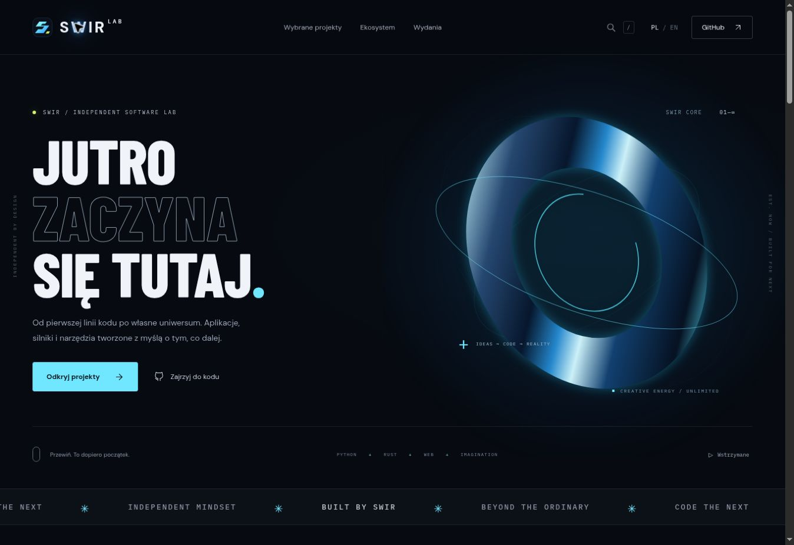

<!-- SWIR-README-STANDARD:v2 -->
<div align="center">


# SWIR — Tomorrow starts right here.

**An independent software universe. Apps, engines and tools by Swir.**

Polish / English · Responsive static website · Native WebGL artwork

[**Explore the website →**](https://swir.github.io/) · [**Browse projects**](https://github.com/Swir?tab=repositories) · [**SWIR OS preview**](https://swir.github.io/swir-os.html)

</div>



## The project showcase

This repository hosts the SWIR project portfolio on GitHub Pages. The homepage introduces Konofix, SwirUI and SwirEngine, followed by a searchable, categorized collection of 22 projects, release links, and a connection to the Swir GitHub profile.

The visual identity combines a custom SWIR mark, electric cyan, oversized typography, a procedural chromium orbital sculpture and project-specific artwork. The Konofix and SwirUI screenshots are actual images from their public repositories; the SwirUI feature illustration and SwirEngine voxel scene are explicitly labeled concept visualizations.

### What visitors can do

| Feature | Behavior |
| --- | --- |
| Project discovery | Search names and descriptions; filter by tools, creators, communication, system, games and media. |
| Project details | Open an accessible dialog with a description, technology and verified links. |
| Releases | Follow real published releases. Projects without a published release have repository links only. |
| PL / EN | Switch the complete interface and project descriptions; the choice stays in the browser. |
| Keyboard access | Use `/` or `Ctrl/Cmd + K` to focus search, Tab to navigate, and Escape to close a project. |
| Motion controls | Pause artwork and decorative animation. Reduced-motion preferences are respected. |
| Responsive layout | Dedicated desktop and phone layouts, including a mobile navigation menu. |

## Data and project status

Project descriptions and release links were checked against public GitHub repositories on **21 October 2026**. They are stored in `swir2046/projects.js`. These are a presentation snapshot, not a substitute for each project's current README, release notes, license or qualification evidence.

The browser optionally refreshes public repository counts, primary languages and stars through GitHub's unauthenticated public API. A six-hour local cache limits requests. The catalog continues to work from the bundled snapshot if the API is unavailable or rate-limited. **New projects and release descriptions are not automatically added**: review and update the catalog deliberately.

A public repository or published artifact does not by itself establish open-source licensing, tested compatibility or production readiness. Alpha, beta and development states are kept visible. No synthetic progress percentages, testimonials or audience metrics are used.

## Local preview

No package installation or compilation is required for the site. From this repository's root:

```sh
python -m http.server 8000
```

Open `http://localhost:8000/`. Use HTTP rather than double-clicking the HTML file: JavaScript ES modules require normal browser module loading.

The page uses self-contained HTML, CSS, JavaScript, SVG and local screenshots. Fonts may load from Google Fonts; system fallbacks are supplied. The public GitHub metadata refresh is optional. There are no analytics, sign-ins, tracking pixels or application secrets.

## Files

```text
index.html                  Portfolio homepage
swir2046/style.css          Responsive design and animation
swir2046/app.js             Catalog, dialogs, language and motion controls
swir2046/projects.js        Checked project and release snapshot
swir2046/core-scene.js      Native WebGL artwork and static fallback
swir2046/mark.svg           Custom SWIR identity
swir2046/screenshots/       Actual project screenshots
swir-os.html               Preserved SWIR OS presentation
SWIR-OS-PREVIEW.md          Preserved previous OS status documentation
```

## GitHub Pages

The existing deployment publishes this repository's `main` branch. The site is buildless and compatible with Pages; `.nojekyll` tells Pages to serve the static assets directly. Existing folders, desktop/OS files and workflows are retained. The previous OS homepage is preserved as `swir-os.html`, with its original dependencies.

## SWIR OS remains a separate product

**[Swir/SWIR_OS](https://github.com/Swir/SWIR_OS)** is the canonical repository for operating-system implementation, architecture, builds, qualification and roadmap truth. This portfolio repository does not own those claims. See the preserved [OS preview documentation](SWIR-OS-PREVIEW.md), the [OS presentation](swir-os.html), and the [canonical architecture](https://github.com/Swir/SWIR_OS/blob/main/SWIR-OS-ARCHITECTURE.md).

Historical web/retro experiments and the independent desktop application remain in this repository. The new homepage does not alter their implementation.

## Verification

The initial portfolio was checked in a real browser for desktop rendering, phone-width layouts, Polish/English switching, search and category filtering, project dialogs, release destinations and pause controls. The static assets are checked for syntax, required files and broken local references. A successful website deployment does not constitute a new functional test of the applications being promoted.

## 🔎 Search Keywords

`SWIR projects` • `Konofix P2P chat` • `SwirUI Python interface` • `SwirEngine Python game engine` • `OCRYON OCR` • `Maxkompilator` • `independent software` • `GitHub project portfolio`

<div align="center">

**Independent mindset. Built by Swir.**

[GitHub profile](https://github.com/Swir) · [All repositories](https://github.com/Swir?tab=repositories)

</div>
