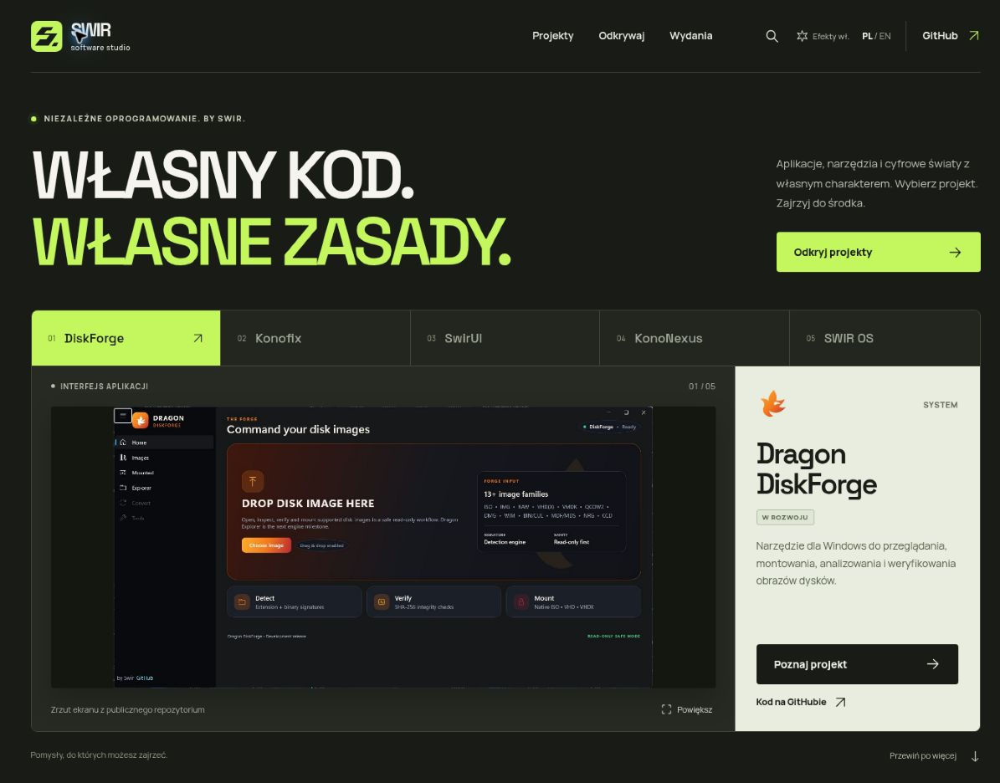

<!-- SWIR-README-STANDARD:v2 -->
<div align="center">


# SWIR — Software Studio

**Your code. Your rules. Independent applications, tools and digital worlds by Swir.**

Polish / English · Responsive static website · Real project screenshots

[**Explore the website →**](https://swir.github.io/) · [**Browse projects**](https://github.com/Swir?tab=repositories) · [**SWIR OS presentation**](https://swir.github.io/swir-os.html)

</div>



## A closer look at the projects

The redesigned portfolio uses deep navy, electric cyan and blue, with large typography, original project identities and an editorial layout.

The opening gallery has **five manually selected tabs**: Dragon DiskForge, Konofix, SwirUI, KonoNexus and SWIR OS. Each shows an actual application screenshot, its description, development stage and project links. Screenshots can be enlarged for a closer look.

Dedicated stories introduce **KonoNexus** and **SWIR OS**. Three further features present **BrokeDJ, OCRYON and SwirEngine** using CSS illustrations explicitly labeled “Project illustration.” These illustrations describe the projects visually; they are not application screenshots. A searchable catalog brings together **22 selected projects**, followed by published releases.

### Explore and navigate

| Feature | Behavior |
| --- | --- |
| Gallery | Select a project tab; use arrow keys, Home or End while focused on the tabs. |
| Catalog | Search project names and descriptions, then filter by category. |
| Project details | Open a dialog with the description, stage, available screenshot and verified repository/release links. |
| Image viewer | Enlarge actual screenshots from the gallery, stories or project details. |
| PL / EN | Switch interface text and project descriptions; the browser remembers the choice. |
| Keyboard | Use `/` or `Ctrl/Cmd + K` for search, Tab to navigate and Escape to close dialogs. |
| Motion | Pause decorative effects; the interface also respects reduced-motion preferences. |
| Mobile | Responsive layouts, touch controls and a compact navigation menu. |

KonoNexus is presented as an **alpha network tester**. The SWIR OS screenshot is labeled **Web Edition**. BrokeDJ remains pre-alpha, and Dragon DiskForge remains in development. Published releases have release links; projects without a release link to their repositories.

## Catalog data

Descriptions, stages and release links are a manually reviewed snapshot from **21 October 2026**, stored in `swir2046/projects.js`. Update that file when adding projects or changing release information.

On a page visit, the browser can refresh the **public repository count, stars and primary languages** through GitHub's public API. Results are cached locally for six hours. The bundled catalog remains usable if the API is unavailable or rate-limited. This refresh does not add projects, rewrite descriptions or discover releases.

## Local preview

The portfolio needs no package installation or build step. In the source checkout, serve its static directory:

```sh
python -m http.server 8000 --directory dist
```

Open [http://localhost:8000/](http://localhost:8000/). In an exported GitHub Pages checkout where `index.html` is already at the root, omit `--directory dist`.

Use HTTP instead of opening the HTML directly so JavaScript modules load normally. Screenshots and project icons are local assets. Google Fonts supplies Manrope and Space Grotesk, with system font fallbacks; the GitHub metadata request is optional to the browsing experience.

### Main files

Paths below are relative to the published site root, or to `dist/` in the source checkout.

```text
index.html                     Portfolio homepage
swir2046/style.css             Layout, project illustrations and motion
swir2046/app.js                Gallery, catalog, dialogs, languages and metadata
swir2046/projects.js           Reviewed project and release snapshot
swir2046/mark.svg              Portfolio identity
swir2046/icons/                Original project logos and icons
swir2046/screenshots/          Actual application screenshots
swir2046/preview-studio.jpg    Website preview
swir-os.html                  Preserved SWIR OS presentation
```

The site is compatible with GitHub Pages and uses `.nojekyll` for static serving. The previous OS presentation and its dependencies remain available at `swir-os.html`.

## Original project assets

The project icons below are copied from their public source repositories. Their identities are preserved; the portfolio mark and labeled CSS illustrations belong to this website.

| Local asset in `swir2046/icons/` | Original source |
| --- | --- |
| `swir-os-logo.svg` | [SWIR_OS/assets/branding/swir-os-logo.svg](https://github.com/Swir/SWIR_OS/blob/main/assets/branding/swir-os-logo.svg) |
| `swir-os-icon.svg` | [SWIR_OS/swir-icon.svg](https://github.com/Swir/SWIR_OS/blob/main/swir-icon.svg), retained from the existing site |
| `kononexus-icon.png` | [KonoNexus/assets/kononexus-tester.png](https://github.com/Swir/KonoNexus/blob/main/assets/kononexus-tester.png) |
| `konofix-icon.ico` | [Konofix/src-tauri/icons/icon.ico](https://github.com/Swir/Konofix/blob/main/src-tauri/icons/icon.ico) |
| `swirui-icon.svg` | [Swirui/assets/swirui-icon.svg](https://github.com/Swir/Swirui/blob/main/assets/swirui-icon.svg) |
| `ocryon-icon.svg` | [OCRYON/src/ocryon/assets/ocryon.svg](https://github.com/Swir/OCRYON/blob/main/src/ocryon/assets/ocryon.svg) |
| `brokedj-icon.svg` | [BrokeDJ/assets/icon.svg](https://github.com/Swir/BrokeDJ/blob/main/assets/icon.svg) |
| `dragon-diskforge-sigil.svg` | [Dragon-DiskForge/docs/branding/dragon-sigil.svg](https://github.com/Swir/Dragon-DiskForge/blob/main/docs/branding/dragon-sigil.svg) |

Screenshots come from `docs/screenshots/application.jpg` in [Konofix](https://github.com/Swir/Konofix/blob/main/docs/screenshots/application.jpg), [Swirui](https://github.com/Swir/Swirui/blob/main/docs/screenshots/application.jpg), [KonoNexus](https://github.com/Swir/KonoNexus/blob/main/docs/screenshots/application.jpg), [SWIR_OS](https://github.com/Swir/SWIR_OS/blob/main/docs/screenshots/application.jpg), [BrokeDJ](https://github.com/Swir/BrokeDJ/blob/main/docs/screenshots/application.jpg) and [Dragon-DiskForge](https://github.com/Swir/Dragon-DiskForge/blob/main/docs/screenshots/application.jpg). OCRYON uses [docs/screenshots/application.png](https://github.com/Swir/OCRYON/blob/main/docs/screenshots/application.png). They show the actual interfaces and states described by their source READMEs.

## SWIR OS is a separate product

**[Swir/SWIR_OS](https://github.com/Swir/SWIR_OS)** is the canonical repository for operating-system implementation, architecture, builds, qualification and roadmap. This portfolio promotes the project; its screenshots and links do not establish a new OS release or hardware qualification.

The retained [OS preview documentation](SWIR-OS-PREVIEW.md), [OS presentation](swir-os.html) and [canonical architecture](https://github.com/Swir/SWIR_OS/blob/main/SWIR-OS-ARCHITECTURE.md) provide the relevant context. Historical web/retro experiments and the independent desktop application remain separate from this portfolio homepage.

## 🔎 Search Keywords

`SWIR projects` · `KonoNexus mesh network` · `SWIR OS` · `Konofix P2P chat` · `SwirUI Python interface` · `SwirEngine Python game engine` · `OCRYON OCR` · `BrokeDJ` · `Dragon DiskForge` · `independent software`

<div align="center">

**Independent mindset. Built by Swir.**

[GitHub profile](https://github.com/Swir) · [All repositories](https://github.com/Swir?tab=repositories)

</div>
